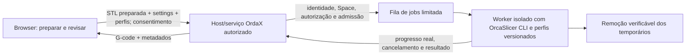

# Fatiamento web — arquitetura e critérios de aceite

## Decisão de produto

O usuário deve conseguir preparar e fatiar um modelo em um navegador sem instalar o OrcaSlicer ou o app desktop. A interface web continua sendo o mesmo app OrdaX; um serviço autorizado executa o OrcaSlicer CLI em um worker isolado e devolve o G-code e os metadados reais do motor.

O modo local continua disponível para quem prefere privacidade, uso offline ou processamento no próprio equipamento. Os dois modos usam a mesma porta `services.slicer` e os mesmos perfis/configurações validados. O primeiro worker remoto deve executar o motor nativo OrcaSlicer com versão e perfis controlados. Um port WebAssembly seria outro motor e exigiria comparação própria de formatos, perfis, configurações e G-code antes de prometer paridade.

## Estado comprovado neste app

- `features/fatiamento-3d/slicer-port.mjs` aceita os destinos `device` e `server`, valida o rótulo do servidor e exige que a confirmação do usuário corresponda ao destino atual.
- Para o servidor, o app envia somente a STL já transformada, configurações permitidas, IDs de perfil e IDs de peças/processos remapeados para aquele trabalho. O arquivo original e a conversa com a IA ficam fora desse envio.
- `server.mjs` é somente o host de desenvolvimento local: vincula em `127.0.0.1`, valida origem local e anuncia execução no dispositivo. Não recebe conexões web de outros equipamentos e não implementa uma fila remota.
- Portanto, abrir a interface no navegador já é possível; fatiar em um serviço web sem Orca instalado no computador do usuário ainda não está disponível.

## Fluxo alvo

O serviço OrdaX deriva identidade e Space da sessão verificada. Não aceita `userId`, `spaceId`, plano, cota, caminho de perfil ou executável fornecidos como autoridade pelo navegador. Os IDs de perfis enviados pelo app são resolvidos contra o catálogo versionado do worker; o caminho físico permanece no servidor.

## Contratos necessários antes de implementar a API de jobs

1. **Identidade e Space:** o host/Platform confirma a sessão e o vínculo ativo ao Space no pedido e novamente antes de entregar o resultado. O app não cria login, token store, membership check ou grants próprios.
2. **Autorização e cotas:** o owner canônico decide se o usuário pode iniciar o serviço e reserva capacidade no servidor. O contrato de cotas existente pode servir à medição, mas uma resposta de cota não concede autoridade de ação. Não há plano/cota de fatiamento a inventar no app.
3. **Ciclo de vida do job:** a API autorizada precisa definir criação idempotente, estado opaco, progresso, cancelamento e recuperação após reinício. Uma requisição HTTP longa não substitui fila durável para trabalhos de fabricação.
4. **Arquivo e resultado:** o host define transferência autenticada com tamanho/digest limitados; o resultado é liberado ao mesmo sujeito/Space e removido após download ou prazo explícito. Não persistir STL ou G-code por padrão.
5. **Worker:** execução em sandbox/container por job, limites de CPU/memória/disco/triângulos/tempo, egress de rede fechado, catálogos somente leitura, cancelamento que encerra o processo e limpeza auditável.
6. **Licença e operação:** pin da versão do motor e dos perfis, proveniência, observabilidade sem conteúdo do modelo, revisão das obrigações AGPL-3.0 e responsável operacional definido antes de aceitar uploads públicos.

Os contratos OS `ordax.background-runtime/1` e `ordax.service-quota-*` são fundações úteis para trabalho limitado e admissão de recursos; eles não são, sozinhos, uma API pública de jobs Orca nem autorizam ativar execução web. O owner correspondente precisa confirmar a composição antes do worker usar esses serviços.

## Estado dos owners canônicos

Na revisão de 2026-10-24, o plano FAB-001 do OrdaX OS está documentalmente pronto, mas marcado como `DEFERRED FOR EXECUTION`, exceto pelo recorte do Profile Pack que os owners do MVP já exigirem. O contrato de Operational Realtime está em estado `PRE-MVP CONTRACT FOUNDATION — RUNTIME POST-MVP`; ele cita jobs e telemetria de impressão como domínios futuros, e mantém slicer, CAD, gestão de farm e protocolos de impressora fora dessa fundação. O plano FAB-001 também deixa a integração com slicers para adapters futuros, quando segura e licenciada.

Esta branch pode continuar a evolução do protótipo e do port `services.slicer`. Um worker web de produção depende de promoção do escopo pelos owners e de um contrato público para identidade, Space, autorização, admissão, ciclo de vida e transferência dos jobs. O app não cria esse contrato em `server.mjs`, não cria outra fila/Runtime e não usa a resposta de cotas como autorização.

Fontes canônicas consultadas: [FAB-001 — OrdaX Fabrication e piloto Impressão 3D](https://github.com/ordaxsystems/ordax-os/blob/main/00-PLANOS-PRIORITARIOS/plans/FAB-001-ORDAX-FABRICATION-3D-PRINTING-PILOT.md) e [Operational Realtime and Device Actions](https://github.com/ordaxsystems/ordax-os/blob/main/docs/OPERATIONAL-REALTIME.md).

## Ciclo de vida esperado

1. O app consulta `services.slicer.getStatus()` e mostra o destino, versão do motor, perfis remotos disponíveis e limites do serviço.
2. Após o usuário confirmar aquele servidor, o host autorizado valida sessão/Space/cota, recebe a malha preparada por streaming e cria um job idempotente.
3. O navegador acompanha `queued → running → completed | failed | cancelled`. Percentuais são apresentados somente quando vierem de eventos reais do Orca; fases sem percentual não viram estimativas.
4. Cancelar revoga o job do usuário atual e encerra o subprocesso. Retry não duplica um job já aceito.
5. Ao concluir, o serviço verifica motor/versão, G-code e digest, devolve estatísticas emitidas pelo Orca e apaga os diretórios temporários. Resultado persistente, se um produto futuro o oferecer, passa por retenção e storage canônicos.

O app já mantém uma chamada `slice()` para o host abstrair esse ciclo. Se a API remota exigir estados assíncronos, o host pode orquestrar criação/poll/cancel internamente, sem vazar tokens ou endpoints privados ao app.

## Aceite para declarar “fatiamento pela web”

- A interface é aberta em um segundo dispositivo/navegador, sem OrcaSlicer instalado nele.
- Usuário sem sessão válida, membro sem autorização, Space incorreto e solicitação acima da cota são recusados pelo serviço; alterar campos no cliente não muda essas decisões.
- STL/3MF real passa pelo worker com Orca e perfis pinados; versão, perfis, estatísticas, preview e G-code pertencem ao mesmo resultado do job.
- O teste inclui job lento, progresso, cancelamento, desconexão/reconexão, retry idempotente e falha do worker.
- Depois do sucesso, falha e cancelamento, a limpeza do conteúdo temporário é verificada. Logs de operação não contêm malha, G-code, chaves ou caminho privado do usuário.
- A instalação/serviço respeita o parecer de licença e limites de abuso/custo definidos pelos owners.

## Próximo passo

Apps já tem a seleção de destino, consentimento e payload mínimo no contrato `services.slicer`. O próximo passo de produto, quando os owners promoverem esse escopo, é consolidar a API de job remoto no port público do host e integrar os adapters do OS/Platform para sessão, Space, autorização e admissão. Até essa promoção, a branch continua a evolução do protótipo e do modo local. A implementação do worker vem ligada ao contrato canônico; não se publica um endpoint anônimo ou uma fila paralela em `server.mjs`.
